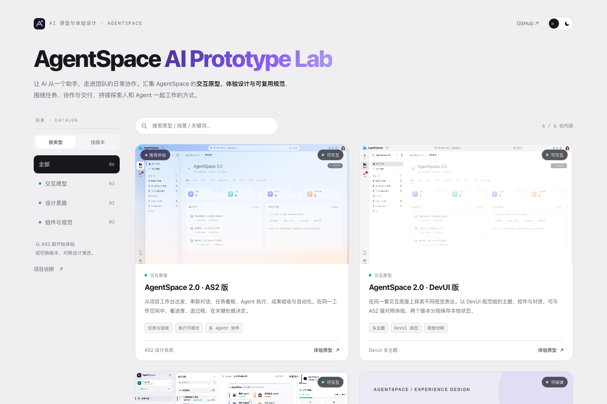

# AgentSpace · AI 原型与体验设计

> 把团队级 Agent 工作系统，做成看得懂、控得住、信得过、留得下的协作体验。

AgentSpace 的 AI 交互原型与设计资产聚合仓库，持续探索 **任务委托 → Agent 协作 → 过程追踪 → 人工验收 → 成果沉淀** 的完整工作流。

**[打开原型聚合页](https://vinniechenyu.github.io/AgentSpace/)** · [体验 AS2 版](https://vinniechenyu.github.io/AgentSpace/demo-as2/) · [查看设计思路](./EXPERIENCE.md)



## 从这里开始

| 原型 / 资产 | 内容 | 入口 |
| --- | --- | --- |
| **AgentSpace 2.0 · AS2 版** · 推荐起点 | 项目工作台、对话、任务看板、执行过程、成果验收、自动化，以及构建 / 扩展 / 进化模块 | [体验原型](https://vinniechenyu.github.io/AgentSpace/demo-as2/) · [版本说明](./demo-as2/README.md) |
| **AgentSpace 2.0 · DevUI 多主题版** | 基于同一交互底座，对照 DevUI 的主题、控件几何与材质表达；本地状态与 AS2 版隔离 | [体验原型](https://vinniechenyu.github.io/AgentSpace/demo-as2-devui/) · [版本说明](./demo-as2-devui/README.md) |
| **AgentSpace · 1.0** | 早期团队空间、任务配置、AgentFlow、执行看板与会话流探索，保留用于版本回看 | [体验原型](https://vinniechenyu.github.io/AgentSpace/demo-classic.html) |
| **DevUI · 多主题设计规范** | 在线阅读 DESIGN.md：8 套主题、Token 映射与组件规则；支持下载原始 Markdown | [阅读 / 下载](https://vinniechenyu.github.io/AgentSpace/devui-multitheme/) · [使用说明](./devui-multitheme/README.md) · [设计规范](./devui-multitheme/DESIGN.md) |

## 我们在探索什么

- **从对话走向任务**：用目标、负责人、执行状态和成果组织协作，让用户知道工作推进到哪里。
- **让执行过程可见**：在同一上下文中查看 Agent 活动、步骤、工具调用和交付件。
- **把人工介入放在关键处**：需要确认、授权或验收时，给出明确的判断对象与操作入口。
- **让配置与执行各有位置**：区分长期能力 / 触发规则与某一次任务执行，支持追踪与复盘。

这些是设计探索与原型表达。原型使用示例数据和本地模拟执行，**不代表已接入真实模型、账号权限、代码仓库、CI 或审批系统**；涉及外部系统的状态与结果仅用于交互演示。不同版本的功能范围以各自说明为准。

## 本地预览

首页使用原生 HTML / CSS / JavaScript，无需安装依赖或构建。

```bash
git clone https://github.com/Vinniechenyu/AgentSpace.git
cd AgentSpace
python3 -m http.server 8000
```

浏览器访问 `http://localhost:8000/`，或直接打开 `index.html`。聚合页支持按类型 / 版本筛选、关键词搜索与深浅主题切换。

AS2 与 DevUI 原型使用浏览器 localStorage 保存演示状态，可在原型的「设置 → 数据与隐私」中重置。聚合页只保存主题偏好，不与原型共享状态。

## 仓库结构

```text
AgentSpace/
├── index.html                  # AI 原型与设计资产聚合首页
├── demo-as2/                   # AgentSpace 2.0 · AS2 原型与构建源文件
├── demo-as2-devui/              # AgentSpace 2.0 · DevUI 多主题原型
├── devui-multitheme/           # DevUI 多主题设计规范、预览与构建源文件
├── demo-classic.html           # 原首页 Demo 原样保留
├── assets/                     # 聚合页品牌标识与预览图
├── aurora-ink-design/           # Aurora Ink 设计规范与组件模板
├── skills/                     # 可复用的工作台原型 Skill
├── EXPERIENCE.md               # 原 README 体验设计长文归档
├── product-definition.md        # 既有产品定义材料
└── README.md
```

## 维护与发布

- **新增资源**：在 `index.html` 的 `items` 数组添加标题、类型、版本、链接、预览图、描述和标签，并同步更新 README 的入口表。筛选数量由页面自动计算。
- **预览图**：原型使用实际页面截图；文档使用标题封面。图片保存在 `assets/previews/`，建议 16:9。
- **修改原型**：AS2 与 DevUI 的生成方式分别见对应目录的 README；聚合页独立维护，不改变原型交互。
- **GitHub Pages**：以仓库根目录提供静态站点，`index.html` 是聚合入口，各原型与设计规范预览保留独立地址。

聚合页布局参考 [CodeArts IDE · AI-UX Design](https://vinniechenyu.github.io/codearts-ide-design/)，采用目录、搜索、截图卡片与深浅主题组织内容。

## 使用说明

本仓库用于产品与体验设计交流。暂未声明开源许可，默认保留所有权利；如需复用，请先与作者沟通。头像等已有素材的来源说明见 [CREDITS](./demo-as2/build/assets/avatars/CREDITS.md)。
